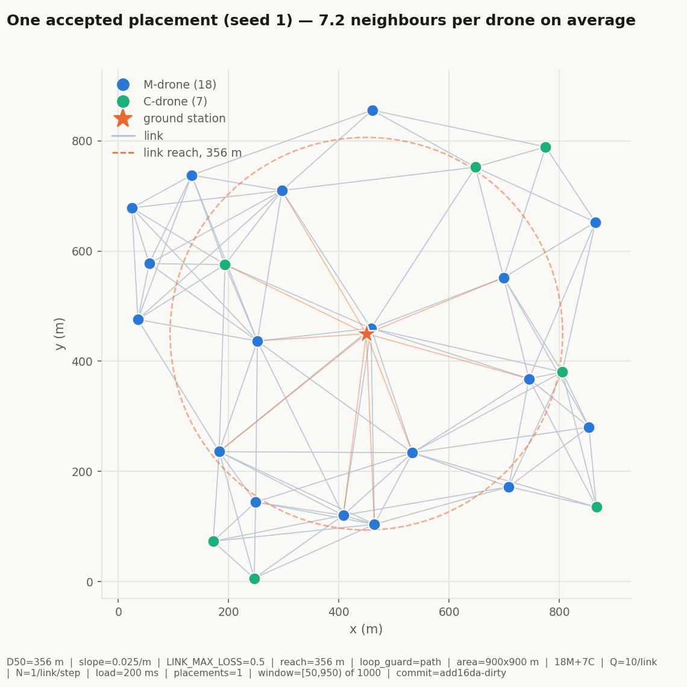
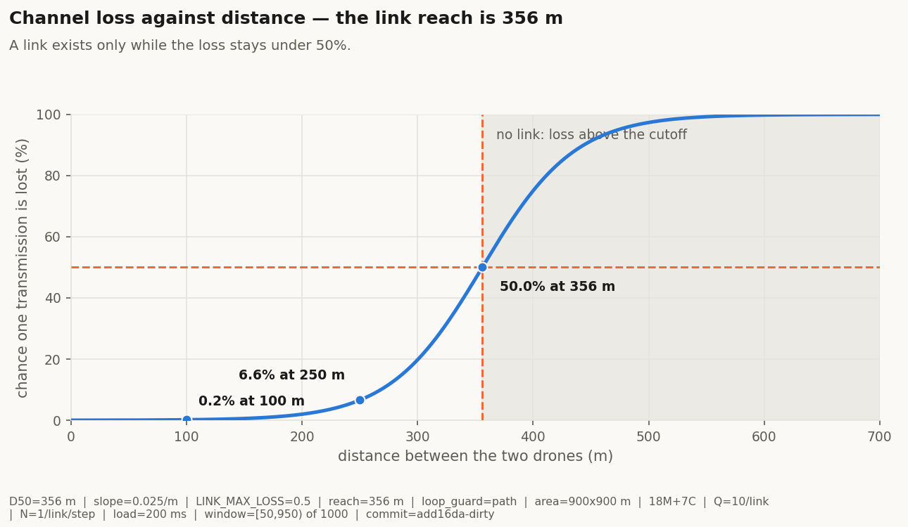
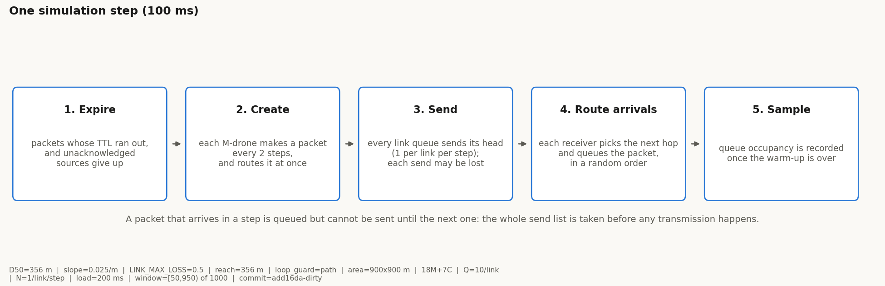

# Routing in a Drone Network: Baselines and a Learned Router

**[SURNAMES]**

**[COURSE NUMBER], [SEMESTER]**

Advisor: Eran, with Prof. Reuven Cohen

---

## Table of Contents

1. [Abstract](#1-abstract)
2. [Introduction](#2-introduction)
3. [Background](#3-background)
4. [The Simulator](#4-the-simulator)
5. [Goals](#5-goals)
6. [Timetable](#6-timetable)
7. [Baselines: Greedy and Random](#7-baselines-greedy-and-random)
8. [Improving the Model](#8-improving-the-model)
9. [The RL Agent](#9-the-rl-agent)
10. [Results](#10-results)
11. [Summary: Difficulties, Further Work, Conclusion](#11-summary-difficulties-further-work-conclusion)
12. [References](#12-references)
13. [Appendix](#13-appendix)

---

## 1. Abstract

_To be written after Phase 2._

---

## 2. Introduction

_To be written after Phase 2._

---

## 3. Background

_To be written after Phase 2._

---

## 4. The Simulator

We wrote our own simulator rather than using an existing one, so that every
rule in it is something we chose and can change. This section describes what
it does now.

**The world.** Twenty-five drones fly over a square area of 900 by 900 metres
with a single ground station, the **GS**, at its centre. The drones are of two
kinds. **M-drones** (mission drones) create packets and also relay other
drones' packets; there are 18 of them. **C-drones** (communication drones)
create nothing and only relay; there are 7. Every packet is headed for the GS,
and a packet that never reaches it is lost. Positions are drawn uniformly at
random and, in Phase 1, nothing moves for the whole run.

Not every random placement is usable. We keep a placement only if **every**
M-drone has some path to the GS through other drones; a placement that strands
an M-drone is discarded and another is drawn. C-drones are allowed to be
isolated, since they create no traffic of their own. Figure 1 shows one
accepted placement.



**Figure 1.** One accepted placement (placement seed 1). M-drones are blue,
C-drones green, the ground station is the orange star. Grey lines are links
between drones and orange lines are links to the GS. The dashed circle is the
356 m link reach, drawn around the GS for scale. In this placement a drone has
7.2 neighbours on average (fewest 4, most 11) and 10 of the 25 drones can
reach the GS in one hop.
<!-- source: rl_sim/scripts/report_figures.py (plot_example_layout, placement seed 1) -->

**The radio.** Whether a transmission arrives depends only on how far apart
the two drones are. The chance that one transmission is lost is

```
p_loss(d) = 1 / (1 + exp(-s * (d - D50)))
```

with `D50 = 356 m` and `s = 0.025` per metre. This is a logistic curve fitted
to measured UAV links rather than a theoretical path-loss formula.
[CITE: Rosati et al., "Dynamic Routing for Flying Ad Hoc Networks",
arXiv:1406.4399] Loss is 0.2% at 100 m, 6.6% at 250 m, 50% at 356 m and 99% at
540 m. The same curve covers the last hop into the GS.
<!-- source: rl_sim/fanet_sim/config.py (LOSS_50_DISTANCE_M, LOSS_SLOPE_PER_M); rl_sim/fanet_sim/envs/channel.py (p_loss) -->

A **link** between two drones exists while that loss stays below 50%, which
puts the edge at exactly 356 m. The idea behind the number is that a drone
only lists another as a neighbour when at least half of its hello messages get
through. The same rule is used everywhere: for neighbour sets, for the link
into the GS, and for the placement filter above. Figure 2 shows the curve and
the cutoff.
<!-- source: rl_sim/fanet_sim/config.py (LINK_MAX_LOSS); rl_sim/fanet_sim/envs/channel.py (link_exists, max_link_distance) -->



**Figure 2.** The chance that one transmission is lost, against the distance
between the two drones. A link exists only while the loss is under 50%, so no
link is ever longer than 356 m and the shaded part of the curve is never used.
<!-- source: rl_sim/scripts/report_figures.py (plot_channel_curve) -->

**Traffic.** Time advances in steps of 100 ms. Each M-drone creates one packet
every fixed number of steps; we sweep four loads, one packet per M-drone every
1000, 500, 200 or 100 ms, and use **200 ms** as the working load. Each M-drone
is given a random offset inside its interval, so the whole fleet does not
create packets on the same step. A packet carries 512 bytes, may take at most
10 hops, and expires 50 steps after it was created.
<!-- source: rl_sim/fanet_sim/config.py (TIMESTEP, TRAFFIC_LOADS_MS, PACKET_INTERVAL_STEPS, RANDOM_TRAFFIC_OFFSETS, PACKET_SIZE, MAX_HOPS, PACKET_TTL) -->

**Queues, one per link.** Each drone keeps a separate FIFO queue for every
outgoing link — one per neighbour, plus one for the GS when the GS is in range.
Each queue holds at most 10 packets and sends at most one packet per step. All
of a drone's queues send in the same step, because we model no competition for
the radio. A packet offered to a queue that is already full is dropped
immediately, with the reason `queue_full`. The GS receives without any limit.
<!-- source: rl_sim/fanet_sim/config.py (QUEUE_CAPACITY, MAX_TX_PER_STEP); rl_sim/fanet_sim/envs/drone.py (enqueue, dequeue_head); rl_sim/fanet_sim/envs/fanet_env.py (_transmit) -->

**Choosing the next hop.** The routing rule runs when a packet is **created**
at a drone or **arrives** at one, and not again afterwards. The drone picks a
next hop there and then and puts the packet in that link's queue; a packet
waiting in the queue for link A→B will be sent to B even if the rule would now
prefer a different neighbour. Arrivals inside one step are handled in a random
but reproducible order, so that the same low-numbered drones do not always get
the last free slot in a nearly full queue.
<!-- source: rl_sim/fanet_sim/envs/fanet_env.py (_route_into_queue, _route_arrivals) -->

**The loop guard.** The packet header carries the list of drones it has already
visited, and no drone may forward a packet to a drone on that list. This is a
property of the network, not of any one routing rule: every rule obeys it. It
is cheap — with 25 drones and at most 10 hops the list is about 4 bytes beside
a 512-byte payload — and it mirrors standard practice in Internet routing,
where a BGP route carries the list of networks it has crossed and a router
discards any route that already contains itself. [CITE: a BGP reference for
AS_PATH loop detection] The GS is never excluded, since it is the destination
rather than a hop to avoid. A packet that still has links but whose every
reachable neighbour is already on its path has nowhere legal to go and is
dropped with the reason `dead_end`.
<!-- source: rl_sim/fanet_sim/config.py (LOOP_GUARD); rl_sim/fanet_sim/envs/fanet_env.py (_allowed_candidates, _route_into_queue) -->

**One step.** Figure 3 shows the order of events inside a step. The order
matters: the list of packets to send is taken before any of them is sent, so a
packet that arrives during a step is queued but cannot move on until the next
step.



**Figure 3.** What happens inside one 100 ms simulation step.
<!-- source: rl_sim/scripts/report_figures.py (plot_step_schematic), following rl_sim/fanet_sim/envs/fanet_env.py (step) -->

**Acknowledgements and how loss is counted.** Acknowledgements are idealised in
Phase 1: they are instant, never lost, and use no capacity. There are two
kinds. A **hop-by-hop** acknowledgement tells a sender whether its transmission
got through, and reports only "delivered" or "lost in the channel". An
**end-to-end** acknowledgement is sent by the GS back to the source when a
packet arrives. Each drone keeps its own counters built only from what it can
see locally and from these acknowledgements. Because the simulator also knows
the truth directly, we can compare the two: every run checks that the drones'
own books agree exactly with the simulator's ground truth, and a run whose two
views disagree is treated as a failure rather than a result.
<!-- source: rl_sim/fanet_sim/envs/drone.py (note_hop_ack, note_gs_ack); rl_sim/scripts/metrics_1a.py (ground_truth_view, ack_view, compare_views) -->

The quantity we care about is **total packet loss**: the share of created
packets that never reach the GS. A packet counts as lost whether it was
dropped or is simply still in flight when the run ends. We also record *why*
each packet was lost, which is one of six reasons: `channel` (a transmission
was lost on the radio), `queue_full` (offered to a full queue), `no_route` (no
candidate next hop at all), `dead_end` (candidates existed but the loop guard
excluded all of them), `ttl` (expired after 50 steps) and `hop_limit` (used up
all 10 hops).
<!-- source: rl_sim/scripts/metrics_1a.py (ground_truth_view); rl_sim/fanet_sim/envs/packet.py (DropReason) -->

A run lasts 1000 steps, but we only count packets created in steps 50 to 949.
The first 50 steps are a warm-up, during which the queues fill from empty, and
the last 50 steps — one full packet lifetime — are a drain, so that we never
count a packet that simply ran out of run rather than out of luck.
<!-- source: rl_sim/fanet_sim/config.py (MAX_STEPS, WARMUP_STEPS, DRAIN_STEPS, measurement_window) -->

**Randomness.** A run is named by two seeds: one for the placement and one for
the channel and traffic. Different routing rules compared against each other
always run on identical placements and identical traffic, and draw their own
random choices from a separate stream, so that switching rule cannot shift the
channel draws. Every result in this report is reproducible from its seeds.
<!-- source: rl_sim/fanet_sim/envs/fanet_env.py (reset, seed handling); rl_sim/agents/rate_router.py (agent_rng) -->

### Parameters

Table 1 lists the settings the simulator runs with. Some are fixed decisions
and some are **provisional** — reasonable modelling choices we made in order to
have a working model, which could be revisited and which the results are
conditional on.

| Parameter | Value | Meaning | Status |
|---|---|---|---|
| `WIDTH`, `HEIGHT` | 900 m | Square area the drones fly over. | fixed |
| `GS_POSITION` | (450, 450) | Ground station, at the centre. | fixed |
| `NUM_M_DRONES` | 18 | Mission drones: create and relay. | fixed |
| `NUM_C_DRONES` | 7 | Communication drones: relay only. | fixed |
| `STATIC_MODE` | true | Nothing moves during a run (Phase 1). | fixed |
| `REQUIRE_CONNECTED_M` | true | Only use placements where every M-drone can reach the GS. | fixed |
| `LOSS_50_DISTANCE_M` | 356 m | Distance at which half of all transmissions are lost. | provisional |
| `LOSS_SLOPE_PER_M` | 0.025 | How sharply the loss curve rises with distance. | provisional |
| `LINK_MAX_LOSS` | 0.5 | A link exists while loss stays below this, giving a 356 m reach. | provisional |
| `QUEUE_CAPACITY` | 10 | Packets held per **link** queue. | fixed |
| `MAX_TX_PER_STEP` | 1 | Packets each link queue sends per step. | fixed |
| `LOOP_GUARD` | `"path"` | A packet may not return to any drone it has visited. | provisional |
| `PACKET_TTL` | 50 steps | How long a packet lives. | fixed |
| `MAX_HOPS` | 10 | Most hops a packet may take. | fixed |
| `PACKET_SIZE` | 512 bytes | Payload size; nothing depends on it. | fixed |
| `TIMESTEP` | 0.1 s | One simulation step. | fixed |
| `MAX_STEPS` | 1000 | Steps per run. | provisional |
| `PACKET_INTERVAL_STEPS` | 2 (200 ms) | Steps between packets at each M-drone; the working load. | fixed |
| `TRAFFIC_LOADS_MS` | 1000, 500, 200, 100 | The four loads we sweep. | fixed |
| `RANDOM_TRAFFIC_OFFSETS` | true | Each M-drone gets a random phase in its interval. | provisional |
| `WARMUP_STEPS` | 50 | Steps skipped at the start of the measurement. | provisional |
| `DRAIN_STEPS` | 50 | Steps skipped at the end (one packet lifetime). | provisional |

**Table 1.** The simulator's settings. "Provisional" marks a modelling choice
rather than a fixed requirement.
<!-- source: rl_sim/fanet_sim/config.py -->

### What we simplified

The model is deliberately simple, and the following are the main things it
leaves out. Each one is a limit on what our results can claim.

- **Two dimensions.** The drones fly on a plane; there is no altitude.
- **A static world.** Nothing moves during a run. Movement is Phase 2.
- **No competition for the radio.** There is no MAC layer, no interference and
  no collisions. This is exactly why each link gets its own queue and its own
  per-step budget, and why one drone can send on all of its links at once. A
  real radio could not do this.
- **Loss depends on distance alone.** Not on traffic, antenna direction, or
  what other drones are transmitting at the same moment.
- **Ideal acknowledgements.** Instant, never lost, and free. Real ones would
  cost airtime and could themselves go missing.
- **No retransmissions.** A transmission lost on the radio loses the packet.
- **Hello messages are not simulated.** Each drone is simply given its
  neighbours' positions and link quality, as though it had learned them from
  periodic hello messages that are free and always current.
- **Energy is tracked but constrains nothing.** No drone ever runs out.
- **Results are conditional on the placement filter.** Every number describes a
  *connected* deployment, not an arbitrary one.

---

## 5. Goals

_To be written after Phase 2._

---

## 6. Timetable

_To be written after Phase 2._

---

## 7. Baselines: Greedy and Random

_To be written._

---

## 8. Improving the Model

_To be written._

---

## 9. The RL Agent

_To be written._

---

## 10. Results

_To be written._

---

## 11. Summary: Difficulties, Further Work, Conclusion

_To be written after Phase 2._

---

## 12. References

_To be written after Phase 2._

<!--
Running list of citations still needed:
- [CITE: Rosati et al., "Dynamic Routing for Flying Ad Hoc Networks",
  arXiv:1406.4399] — the measured UAV link study the loss curve is fitted to.
  Cited in section 4 (The Simulator).
- [CITE: a BGP reference for AS_PATH loop detection] — the standard precedent
  for carrying a visited-list in the header. Cited in section 4.
-->

---

## 13. Appendix

_To be written after Phase 2._
