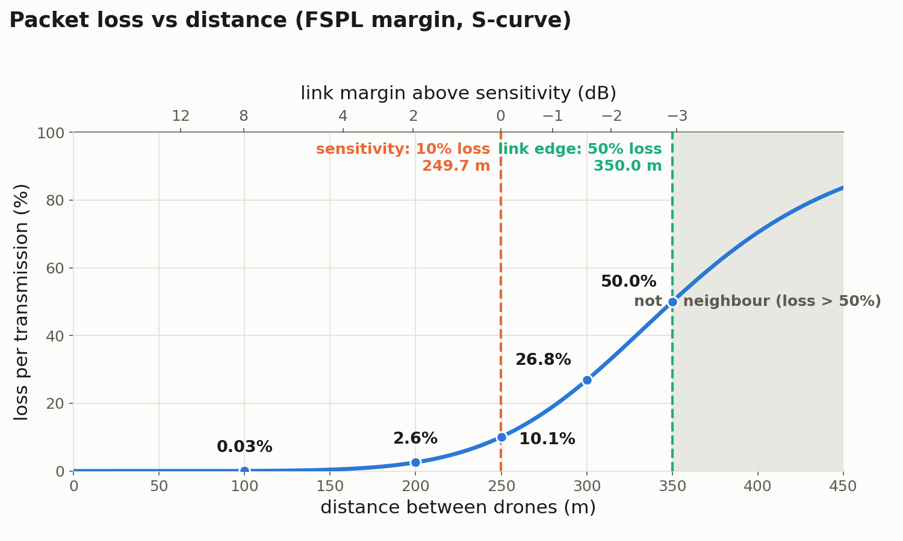
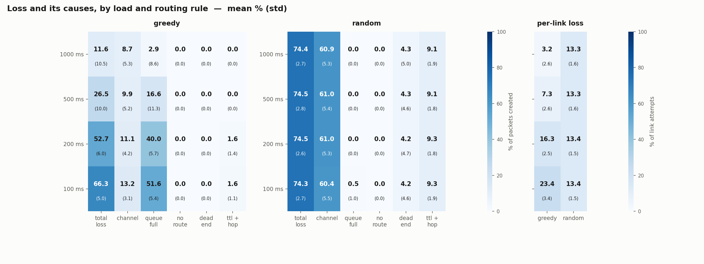

# Routing in a Drone Network: Baselines and a Learned Router

**[SURNAMES]**

**[COURSE NUMBER], [SEMESTER]**

Advisor: Eran, with Prof. Reuven Cohen

---

## Table of Contents

1. [Abstract](#1-abstract)
2. [Introduction](#2-introduction)
3. [Background](#3-background)
4. [The Simulator](#4-the-simulator)
5. [Goals](#5-goals)
6. [Timetable](#6-timetable)
7. [Baselines: Greedy and Random](#7-baselines-greedy-and-random)
8. [Improving the Model](#8-improving-the-model)
9. [The RL Agent](#9-the-rl-agent)
10. [Results](#10-results)
11. [Summary: Difficulties, Further Work, Conclusion](#11-summary-difficulties-further-work-conclusion)
12. [References](#12-references)
13. [Appendix](#13-appendix)

---

## 1. Abstract

_To be written after Phase 2._

---

## 2. Introduction

_To be written after Phase 2._

---

## 3. Background

_To be written after Phase 2._

---

## 4. The Simulator

We built our own simulator in Python, so we could control every part
of it.

**Components:**
1. **Area:** a square of 900 × 900 m.
2. **Ground station (GS):** at the centre of the area. All packets are
   sent to the GS.
3. **M-drones (18):** mission drones. They create packets and also
   forward packets of other drones.
4. **C-drones (7):** communication drones. They only forward packets.

In Phase 1 the drones do not move. Their positions are chosen at
random. We only keep a layout if every M-drone can reach the GS
through other drones; otherwise a new layout is drawn.

**Figure 1:** An example layout. Solid lines are good links, dotted
lines are weak links. The orange arrows show one route to the GS.

**Radio channel**

A transmission can be lost, and the chance of loss grows with the
distance between the two drones. We compute it in two steps:

1. **Margin:** how much stronger the received signal is than the
   receiver's sensitivity, using the free-space path loss (FSPL)
   formula:
   M = P_T + G_T + G_R − FSPL(d) − S
2. **Loss:** the margin is turned into a loss probability with an
   S-shaped curve:
   p_loss = 1 / (1 + 9·e^(b·M))

Where:
- d: distance between the drones
- P_T: transmit power, 1 W [CITE: IQMR]
- G_T, G_R: antenna gains, 2 dBi
- S: receiver sensitivity, the power at which 10% of packets are lost
  [CITE: 802.11 receiver minimum input sensitivity]
- b: set so that the loss is 50% at 350 m

Real wireless links behave this way: reliable up to some distance,
then a gradual rise in loss, then no connection [CITE: Zúñiga &
Krishnamachari 2004].

Free space alone would give a range of kilometres, because it ignores
the ground, obstacles and interference. We therefore set S = −54 dBm,
so that the loss is 10% at 250 m, the range reported for 1 W drone
radios [CITE: IQMR].

| distance | 100 m | 200 m | 250 m | 300 m | 350 m |
|---|---|---|---|---|---|
| loss | 0.03% | 2.6% | 10% | 27% | 50% |
<!-- source: rl_sim/fanet_sim/envs/channel.py (p_loss); rl_sim/fanet_sim/config.py -->

**Figure 2:** Loss per transmission as a function of distance.

**Links and range**

Two drones have a link if the loss between them is below 50%, which
means they are less than 350 m apart. The same rule applies to the GS.

We chose 350 m by testing several ranges on 3000 random layouts:

| range | layouts where all M-drones reach the GS | M-drones that reach the GS directly |
|---|---|---|
| 300 m | 81% | 35% |
| 350 m | 95% | 48% |
| 400 m | 99% | 62% |
| 450 m | 99.8% | 78% |
<!-- source: rl_sim/out/edge_scan.csv -->

At 350 m almost all layouts are connected, and about half of the
M-drones still need other drones to reach the GS. With a longer range
most drones reach the GS directly, so there is little left to route.
The range was chosen before running any routing experiment with this
channel.

**Traffic**

Time moves in steps of 100 ms. Each M-drone creates one packet every
200 ms (our main load). We also test one packet every 1000, 500 and
100 ms. The drones do not all send at the same moment: each one starts
at a random offset.

A packet may take at most 10 hops and is dropped if it is not
delivered within 5 seconds (50 steps). The choice of 200 ms is
explained in section 7.
<!-- source: rl_sim/fanet_sim/config.py (TIMESTEP, PACKET_INTERVAL_STEPS, TRAFFIC_LOADS_MS, RANDOM_TRAFFIC_OFFSETS, MAX_HOPS, PACKET_TTL) -->

**Queues**

Each drone has a separate queue for every link: one per neighbour, and
one for the GS if it is in range. Each queue holds up to 10 packets
and sends one packet per step. All of a drone's queues can send in the
same step, since we do not model interference between transmissions.
A packet that arrives at a full queue is dropped.
<!-- source: rl_sim/fanet_sim/config.py (QUEUE_CAPACITY, MAX_TX_PER_STEP) -->

**Routing**

When a packet is created or arrives at a drone, the drone chooses the
next hop and puts the packet in that link's queue. This choice is not
changed later, even if the queue is long.

**Loop guard**

Each packet carries a list of the drones it has already visited, and a
drone may not send it to any of them. This prevents packets from going
in circles. A similar idea is used in Internet routing (BGP)
[CITE: BGP AS_PATH].

**One time step**

In each 100 ms step:
1. Packets older than 5 seconds are dropped.
2. M-drones create new packets and choose a next hop for each one.
3. Each queue sends its first packet. The packet may be lost on the
   way.
4. Drones that received packets choose a next hop and put them in a
   queue.

A packet received in a step is sent on the next step at the earliest.

**Acknowledgements**

Drones learn what happened to their packets from acknowledgements
(ACKs):
1. **Hop ACK:** tells the sender whether its transmission reached the
   next drone.
2. **End-to-end ACK:** when a packet reaches the GS, an ACK goes back
   along its route, so every drone that forwarded it learns it was
   delivered.
3. **No ACK:** if no ACK arrives within 5 seconds, each drone that
   forwarded the packet counts it as lost.

In Phase 1, ACKs are ideal: they arrive instantly, are never lost and
use no capacity. In every run used for a result, we check that what
the drones learn from ACKs matches what really happened in the
simulation.

**Measuring loss**

Our main metric is **total packet loss**: the percentage of created
packets that never reach the GS. Each lost packet has one reason:

| reason | meaning |
|---|---|
| channel | lost on the way between two drones |
| queue_full | arrived at a full queue |
| no_route | the drone had no neighbour to send to |
| dead_end | all neighbours were already visited (loop guard) |
| ttl | not delivered within 5 seconds |
| hop_limit | used all 10 hops |

Each run lasts 1000 steps (100 s). We only count packets created
between steps 50 and 950. The first 50 steps let the queues fill up,
and the last 50 give every counted packet time to finish.

All routing rules are tested on the same layouts and the same traffic,
so their results can be compared directly. Every result can be
reproduced from its random seeds.
<!-- source: rl_sim/fanet_sim/config.py (MAX_STEPS, WARMUP_STEPS, DRAIN_STEPS); rl_sim/scripts/metrics_1a.py -->

**Parameters**

| parameter | value |
|---|---|
| area | 900 × 900 m |
| ground station | at the centre |
| M-drones / C-drones | 18 / 7 |
| drone movement | none (Phase 1) |
| transmit power | 1 W |
| frequency | 2.4 GHz |
| antenna gain | 2 dBi |
| receiver sensitivity | −54 dBm (10% loss at 250 m) |
| link range | 350 m (50% loss) |
| queue size | 10 packets per link |
| sends per queue per step | 1 |
| time step | 100 ms |
| run length | 1000 steps (100 s) |
| packet rate per M-drone | 1 every 200 ms (also tested: 1000, 500, 100 ms) |
| packet lifetime | 5 s |
| max hops | 10 |
| packet size | 512 bytes |

**Table 1:** Simulation parameters.
<!-- source: rl_sim/fanet_sim/config.py -->

---

## 5. Goals

_To be written after Phase 2._

---

## 6. Timetable

_To be written after Phase 2._

---

## 7. Baselines: Greedy and Random

Before building a learning agent, we tested two simple routing rules
as baselines:

1. **Greedy:** the drone looks only at neighbours that are closer to
   the GS than itself, so that every hop makes real progress and the
   packet does not wander around. Among them, it picks the link with
   the lowest loss, and skips links whose queue is full. If no
   neighbour is closer to the GS, the packet is dropped.
2. **Random:** the drone picks one of its neighbours at random, with no
   other rule.

Both rules obey the loop guard, and both use only information the
drone has locally.

**Results**

We ran both rules on 20 random layouts at each of the four loads.
Figure 3 shows the total loss and its causes.

**Figure 3:** Total packet loss and its causes for greedy and random,
at each load (mean over 20 layouts, standard deviation in brackets).

Greedy loses much less than random at every load. Most of greedy's
loss comes from **full queues**: since every drone sends towards the
GS, many packets pass through the same few links and their queues fill
up. As the load grows, this gets worse (2.9% at 1000 ms, 40% at
200 ms).

Random loses about 74% at every load. It does not move towards the GS,
so packets take many hops and most are lost on the **channel** along
the way (61%). Its queues never fill up, so the load does not matter.
<!-- source: rl_sim/out/1a_runs.csv -->

**Choosing the main load**

We use 200 ms as the main load for the rest of the project. It is the
heaviest load where the network is busy but not overloaded:
- **Busy:** at 200 ms, 40% of greedy's packets are lost to full
  queues, so the routing choice matters.
- **Not overloaded:** greedy still beats random on all 20 layouts. At
  100 ms it wins on only 18 of 20, and the gap shrinks from 22 to 8
  points.
<!-- source: rl_sim/out/1a_runs.csv, rl_sim/out/1a_paired.csv -->

---

## 8. Improving the Model

_To be written._

---

## 9. The RL Agent

_To be written._

---

## 10. Results

_To be written._

---

## 11. Summary: Difficulties, Further Work, Conclusion

_To be written after Phase 2._

---

## 12. References

_To be written after Phase 2._

<!--
Running list of citations still needed:
- [CITE: IQMR] — Sharvari et al. 2024, arXiv:2408.09109. The UAV study the
  radio constants come from: 1 W transmit power, and the 250 m range quoted
  for 1 W drone radios. Cited twice in section 4 (The Simulator).
- [CITE: 802.11 receiver minimum input sensitivity] — the clause defining
  sensitivity as the power giving a 10% packet error rate, which is what
  anchors the loss curve. Cited in section 4.
- [CITE: Zuniga & Krishnamachari 2004] — for the claim that real wireless
  links are reliable up to some distance, then degrade gradually, then fail.
  Cited in section 4.
- [CITE: BGP AS_PATH] — the standard precedent for carrying a visited-list in
  the packet header. Cited in section 4.
-->

---

## 13. Appendix

_To be written after Phase 2._
