# Routing in a Drone Network: Baselines and a Learned Router

**Abed Badran and Zina Assi**

**02360340, Spring 2026**

Advisor: Eran, with Prof. Reuven Cohen

---

## Table of Contents

1. [Abstract](#1-abstract)
2. [Introduction](#2-introduction)
3. [Background](#3-background)
4. [The Simulator](#4-the-simulator)
5. [Goals](#5-goals)
6. [Timetable](#6-timetable)
7. [Baselines: Greedy and Random](#7-baselines-greedy-and-random)
8. [The RL Agent](#8-the-rl-agent)
9. [Results](#9-results)
10. [Phase 2a: The Moving World](#10-phase-2a-the-moving-world)
11. [Phase 2c: Moving the C-drones with RL](#11-phase-2c-moving-the-c-drones-with-rl)
12. [Summary: Difficulties, Further Work, Conclusion](#12-summary-difficulties-further-work-conclusion)
13. [References](#13-references)
14. [Appendix](#14-appendix)

---

## 1. Abstract

In a drone network, mission drones (M-drones) send data to a ground
station (GS), often through other drones. Packets are lost when links
are long, queues fill up, or drones move away. Our goal was to lose as
few packets as possible, using reinforcement learning (RL).

We built our own simulator for this. First, in a static world, we
compared simple routing rules with an RL router. The RL router lost
10.8% of the packets, against 11.9% for the best simple rule and 25.0%
for greedy routing.

Next, we let the drones move and added relay drones (C-drones) whose
only job is to carry packets. We trained an RL agent that decides where
the C-drones fly. In a full fleet it lost 16.4% of the packets, against
24.3% for a simple rule that places each C-drone halfway to the
farthest drone. Tests on small, hand-built cases showed a weakness:
the agent stayed near the GS and abandoned drones that flew away alone.
Training it on varied missions fixed some of these cases. On varied
missions it then lost 10.4%, close to the simple rule (9.2%), and it
kept its lead in the full fleet (16.4% against 24.3%).

The RL agents work best in large, busy networks. In small fleets the
simple rule loses fewer packets, so a real system could combine the
two.
<!-- source: rl_sim/out/1b_test50_runs.csv (200 ms: rl 10.77, rate 11.93, greedy 24.97); rl_sim/out/2c_r2_test.csv (full 601-650: control 16.35, B 16.44, midpoint 24.34; varied 651-750: B 10.35, midpoint 9.22); edge cases rl_sim/out/2c_r2_edge.csv. The small-fleet claim (1-6 M-drones: B 18.72 vs midpoint 11.01) was computed from 2c_r2_test.csv and is not yet in a saved file. -->

---

## 2. Introduction

A group of drones that talk to each other by radio is called a flying
ad-hoc network (FANET). In our network there are two kinds of drones.
Mission drones (M-drones) collect data and send it to a ground station
(GS). Relay drones (C-drones) create no data; they only carry other
drones' packets.

Let's look at a very simple network: a GS, one M-drone and one C-drone.

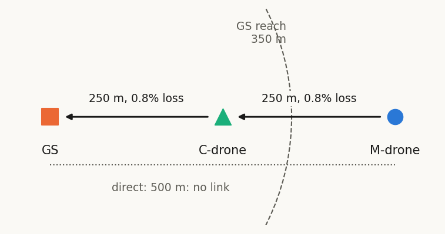

**Figure 1:** The M-drone is too far from the GS, so its packets go
through the C-drone.

When the M-drone flies away, its link gets longer and more packets are
lost. The C-drone can fly between them, so each packet makes two short
hops instead of one long one. With many drones, queues can also fill up,
and moving drones can break routes.

So two decisions matter: which neighbour each drone sends to (routing),
and where the C-drones fly (placement). We asked whether reinforcement
learning (RL) can make these decisions better than simple rules.

We studied routing in a static world (Phase 1), then let the drones
move and tested simple placement rules for the C-drones (Phase 2a).
Finally, we trained an RL agent that places the C-drones (Phase 2c). In
Phase 2c the packets are routed by the simple greedy rule, so that any
gain comes from placement alone. RL routing in the moving world
(Phase 2b), and the two agents together, are left for future work.

---

## 3. Background

**Routing in a drone network**

In a FANET the drones move, so routes change all the time. A common
simple approach is greedy forwarding [1]: each
drone sends a packet to the neighbour that is closest to the
destination. It needs no route tables, only the positions of the
neighbours, which the drones learn from short "hello" messages they
send to each other.

**Reinforcement learning (RL)**

In RL, an agent learns by trial and error [2].
At each step it looks at the state of its environment, chooses an
action, and receives a reward. Over many tries it learns which actions
lead to more reward.

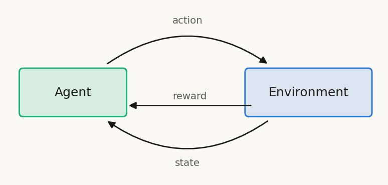

**Figure 2:** The RL loop. The agent sees the state, acts, and gets a
reward.

In Phase 1, the agent is a drone choosing the next hop for a packet.
The reward is 1 if the packet reaches the GS and 0 if it does not, and
every drone that chose a hop for that packet receives the same reward.

In Phase 2c, the agent is a C-drone choosing where to fly. Every
second, all C-drones receive the same reward: the packets delivered in
that second minus the packets lost in that second, divided by the
packets created in that second, minus a small charge for the distance
the drone flew.

**Actor and critic (PPO)**

For Phase 2c we used PPO [3], a common RL
method with two networks:
- The **actor** chooses the action.
- The **critic** estimates how much reward is still to come, so the
  actor can tell whether an action was better or worse than expected.

PPO also keeps each learning step small, so the actor does not change
too much at once.

All C-drones work as one team and share one actor. During training
only, the critic sees the whole network [4]. When
flying, each C-drone uses only the actor, with its own state and the
hello messages it receives from its neighbours.

---

## 4. The Simulator

We built our own simulator in Python, so we could control every part
of it.

**Components:**
1. **Area:** a square of 900 × 900 m.
2. **Ground station (GS):** at the centre of the area. All packets are
   sent to the GS.
3. **M-drones (18):** mission drones. They create packets and also
   forward packets of other drones.
4. **C-drones (7):** communication drones. They only forward packets.

In Phase 1 the drones do not move. Their positions are chosen at
random. We only keep a layout if every M-drone can reach the GS
through other drones; otherwise a new layout is drawn.

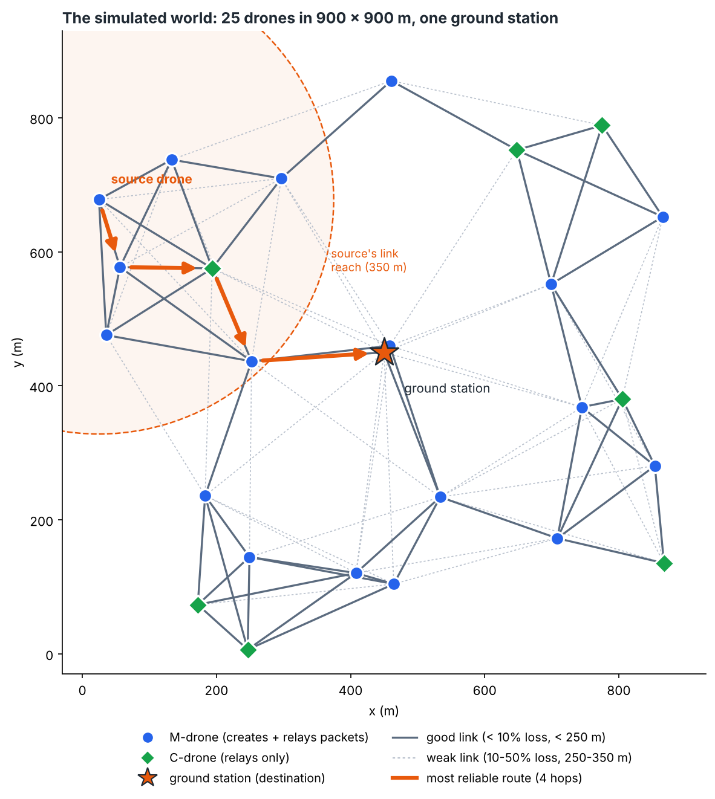

**Figure 3:** An example layout. Solid lines are good links, dotted
lines are weak links. The orange arrows show one route to the GS.

**Radio channel**

A transmission can be lost, and the chance of loss grows with the
distance between the two drones. We compute it in two steps:

1. **Margin:** how much stronger the received signal is than the
   receiver's sensitivity, using the free-space path loss (FSPL)
   formula:
   M = P_T + G_T + G_R − FSPL(d) − S
2. **Loss:** the margin is turned into a loss probability with an
   S-shaped curve:
   p_loss = 1 / (1 + 9·e^(b·M))

Where:
- d: distance between the drones
- P_T: transmit power, 1 W
- G_T, G_R: antenna gains, 2 dBi
- S: receiver sensitivity, −55.6 dBm: the power at which 10% of
  packets are lost [5]
- b: set so that the loss is 50% at 350 m

Real wireless links behave this way: reliable up to some distance,
then a gradual rise in loss, then no connection [6].

The curve is set by two distances that we chose: 10% loss at 300 m
and 50% loss at 350 m. The 350 m comes from the layout scan below.
With these two points, links work well for most of their range, and
the loss rises quickly only in the last 50 m.

A similar quick rise was measured on a real Wi-Fi link connected by
cable, where the signal is steady [7]. In the open
air the signal changes from moment to moment, so the rise is slower.
We do not model these changes.

The radio values (1 W, 2.4 GHz, 2 dBi, −55.6 dBm) are calibration
values that produce this curve; they do not affect the results.

| distance | 100 m | 200 m | 250 m | 300 m | 325 m | 350 m |
|---|---|---|---|---|---|---|
| loss | <0.01% | 0.03% | 0.8% | 10% | 26% | 50% |
<!-- source: rl_sim/fanet_sim/envs/channel.py (p_loss); rl_sim/fanet_sim/config.py -->

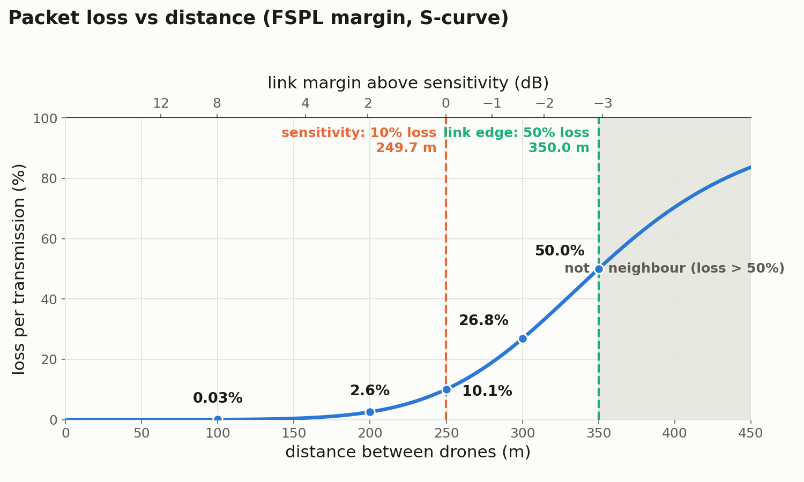

**Figure 4:** Loss per transmission as a function of distance. Beyond
350 m a drone does not accept the other as a neighbour.

**No resends:** a lost transmission is not resent, so one lost hop
loses the packet. Links up to 350 m are allowed, and the last 50 m
lose 10–50%. Real Wi-Fi resends lost packets, so a real network
would lose fewer packets on the channel.

**Links and range**

A drone accepts another drone as a neighbour only if more than half of
its hello messages arrive (loss below 50%). This is our own design
choice; real routing protocols such as OLSR also use link-quality
thresholds for their neighbours [8]. With our loss curve,
the loss reaches 50% at 350 m, so drones more than 350 m apart are not
neighbours. A link losing more than half its packets is rarely useful:
two 175 m hops lose only 0.01%, while one 350 m hop loses 50%.
<!-- source: rl_sim/fanet_sim/envs/channel.py (p_loss): 0.0051% at 175 m, so 0.0102% over two hops; 50.0000% at 350 m -->

We chose 350 m by testing several ranges on 3000 random layouts:

| range | layouts where all M-drones reach the GS | M-drones that reach the GS directly |
|---|---|---|
| 300 m | 81% | 35% |
| 350 m | 95% | 48% |
| 400 m | 99% | 62% |
| 450 m | 99.8% | 78% |
<!-- source: rl_sim/out/edge_scan.csv -->

At 350 m almost all layouts are connected, and about half of the
M-drones still need other drones to reach the GS. With a longer range
most drones reach the GS directly, so there is little left to route.
The range was chosen before running any routing experiment with this
channel.

**Traffic**

Time moves in steps of 100 ms. Each M-drone creates one packet every
200 ms (our main load). We also test one packet every 1000, 500 and
100 ms. The drones do not all send at the same moment: each one starts
at a random offset.

A packet may take at most 10 hops. Each packet has a time to live
(TTL) of 5 seconds (50 steps); if it is not delivered by then, it is
dropped. The choice of 200 ms is explained in section 7.
<!-- source: rl_sim/fanet_sim/config.py (TIMESTEP, PACKET_INTERVAL_STEPS, TRAFFIC_LOADS_MS, RANDOM_TRAFFIC_OFFSETS, MAX_HOPS, PACKET_TTL) -->

**Queues**

Each drone has a separate queue for every link: one per neighbour, and
one for the GS if it is in range. Each queue holds up to 10 packets
and sends one packet per step. All of a drone's queues can send in the
same step, since we assume each link has its own transmitter. A real
drone with a single radio could not do this, and our results depend on
this assumption. A packet that arrives at a full queue is dropped.
<!-- source: rl_sim/fanet_sim/config.py (QUEUE_CAPACITY, MAX_TX_PER_STEP) -->

**Routing**

When a packet is created or arrives at a drone, the drone chooses the
next hop and puts the packet in that link's queue. This choice is not
changed later, even if the queue is long.

**Loop guard**

Each packet carries a list of the drones it has already visited, and a
drone may not send it to any of them. This prevents packets from going
in circles. A similar idea is used in Internet routing (BGP)
[9].

**One time step**

In each 100 ms step:
1. Packets older than 5 seconds, or that used all 10 hops, are
   dropped.
2. M-drones create new packets and choose a next hop for each one.
3. Each queue sends its first packet. The packet may be lost on the
   way.
4. Drones that received packets choose a next hop and put them in a
   queue.

A packet received in a step is sent on the next step at the earliest.

**Acknowledgements**

Drones learn what happened to their packets from acknowledgements
(ACKs):
1. **Hop ACK:** tells the sender whether its transmission reached the
   next drone.
2. **End-to-end ACK:** when a packet reaches the GS, an ACK goes back
   along its route, so every drone that forwarded it learns it was
   delivered.
3. **No ACK:** if the packet is not delivered within its 5-second
   lifetime (TTL), each drone that forwarded it counts it as lost.

In Phase 1, ACKs are ideal: they arrive instantly, are never lost and
use no capacity. In every run used for a result, we check that what
the drones learn from ACKs matches what really happened in the
simulation.

**Measuring loss**

Our main metric is total packet loss: the percentage of created
packets that never reach the GS. Each lost packet has one reason:

| reason | meaning |
|---|---|
| channel | lost on the way between two drones |
| queue_full | arrived at a full queue |
| no_route | no allowed neighbour to send to (for greedy: none closer to the GS) |
| dead_end | all neighbours were already visited (loop guard) |
| ttl | not delivered within 5 seconds |
| hop_limit | used all 10 hops |

Each run lasts 1000 steps (100 s). We only count packets created
between steps 50 and 950. The first 50 steps let the queues fill up,
and the last 50 give every counted packet time to finish.

All routing rules are tested on the same layouts and the same traffic,
so their results can be compared directly. Every result can be
reproduced from its random seeds.
<!-- source: rl_sim/fanet_sim/config.py (MAX_STEPS, WARMUP_STEPS, DRAIN_STEPS); rl_sim/scripts/metrics_1a.py -->

**Parameters**

| parameter | value |
|---|---|
| area | 900 × 900 m |
| ground station | at the centre |
| M-drones / C-drones | 18 / 7 |
| drone movement | none (Phase 1) |
| transmit power | 1 W |
| frequency | 2.4 GHz |
| antenna gain | 2 dBi |
| receiver sensitivity | −55.6 dBm (10% loss at 300 m) |
| link range | 350 m (50% loss) |
| queue size | 10 packets per link |
| sends per queue per step | 1 |
| time step | 100 ms |
| run length | 1000 steps (100 s) |
| packet rate per M-drone | 1 every 200 ms (also tested: 1000, 500, 100 ms) |
| packet lifetime | 5 s |
| max hops | 10 |
| packet size | 512 bytes (does not affect the loss) |

**Table 1:** Simulation parameters.
<!-- source: rl_sim/fanet_sim/config.py -->

---

## 5. Goals

Our measure throughout is the total packet loss: the share of created
packets that never reach the GS. Loss by cause (channel, full queues,
no route, and so on) is used only to explain the total.

1. Build a simulator of a drone network with a realistic loss model,
   queues and moving drones.
2. Compare simple routing rules in a static world, and test whether an
   RL router loses fewer packets.
3. Let the drones move, and compare simple rules for placing the
   C-drones.
4. Train an RL agent that decides where the C-drones fly, and test
   whether it loses fewer packets than the simple rules:
   - on fresh layouts it never saw in training;
   - on hand-built edge cases, such as a drone flying away alone.

---

## 6. Timetable

| dates (2026) | phase | what we did |
|---|---|---|
| 27 Sep – 3 Oct | Simulator, Phase 1a | static world, queues, loss model; greedy and random routing |
| 4 – 16 Oct | Phase 1b | RL routing agent; steeper loss curve, every result re-run |
| 20 – 24 Oct | Phase 2a | moving drones, hello messages, re-routing; four C-drone rules |
| 25 Oct – 6 Nov | Phase 2c | RL agent for the C-drones: copying midpoint, PPO, edge cases |
| 7 – 8 Nov | Phase 2c | training on varied missions; final tests on new layouts |
| 8 – 9 Nov | Report | this report |
<!-- source: git commit dates on branches phase-1a, phase-2a and phase-2c: d3145b8 (27 Sep, static world), 989e354 (3 Oct, Phase 1a figures), c0cc4c3 (7 Oct, Phase 1b agent), 3ff9840 (16 Oct, steeper curve re-run), f1a1c23 to dc6e188 (20-24 Oct, Phase 2a), 7dc1c5b (25 Oct, Phase 2c M0/M1) to 5f8fcdc (6 Nov, edge cases), 8427026 to 76928a3 (7-8 Nov, rounds 1-2 and tests) -->

---

## 7. Baselines: Greedy and Random

Before building a learning agent, we tested two simple routing rules
as baselines:

1. **Greedy:** the drone sends each packet to the neighbour closest to
   the GS, and skips neighbours whose queue is full. It only uses
   neighbours closer to the GS than itself, so every hop makes
   progress. If no neighbour is closer, the packet is dropped.
2. **Random:** the drone picks one of its neighbours at random, with no
   other rule.

Both rules obey the loop guard, and both use only information the
drone has locally.

**Results**

We ran both rules on 20 random layouts at each of the four loads.
Figure 5 shows the total loss and its causes.

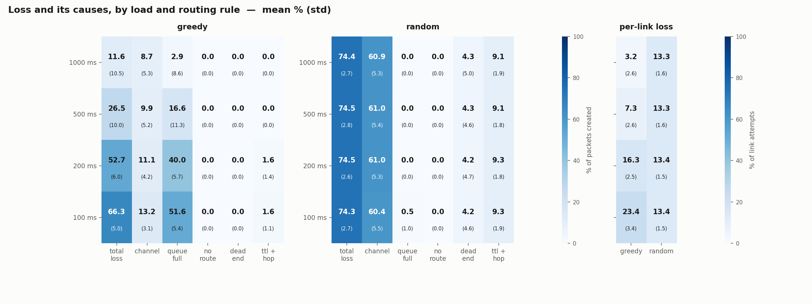

**Figure 5:** Total packet loss and its causes for greedy and random,
at each load (mean over 20 layouts, standard deviation in brackets).

Greedy loses much less than random at every load, on all 20 layouts.
At light loads all of greedy's loss is on the channel (13.9%),
because it takes few, long hops. As the load grows, its queues fill
up.

Random loses about 64% at every load. It does not move towards the
GS, so packets take many hops: many are lost on the channel (39%),
and many use up all 10 hops (19%). Its queues almost never fill up,
so the load does not matter.
<!-- source: rl_sim/out/1a_summary.csv -->

**Choosing the main load**

We use 200 ms as the main load for the rest of the project. At this
load, greedy loses about as many packets to full queues (14.5%) as on
the channel (13.8%), so the routing has to deal with both. At 500 ms
no packets are lost to full queues, and at 100 ms full queues are the
main cause of loss (35.1%).
<!-- source: rl_sim/out/1a_summary.csv, rl_sim/out/1a_paired.csv -->

---

## 8. The RL Agent

**The RL setup**

| RL part | in our problem |
|---|---|
| agent | each drone (all drones share one network) |
| environment | the simulated drone network |
| state | for each possible next hop: its delivery rate, queue fill and channel loss |
| action | choosing the next hop for a packet |
| reward | 1 if the packet reaches the GS, 0 if it is lost |
| episode | one run on one layout (1000 steps) |

**Table 2:** The RL setup.
<!-- source: rl_sim/agents/rl_router.py; rl_sim/fanet_sim/config.py (MAX_STEPS) -->

The reward comes late: only when the packet reaches the GS or is lost.
It is then given to every drone that forwarded the packet, for the
choice it made. The network learns the expected reward of each
action, which is the chance that the packet will reach the GS. The
drone then picks the action with the highest expected reward.

**The model**

Each drone uses a small neural network to choose the next hop. For
every possible link, the network gets three inputs, all known to the
drone itself:
1. **Delivery rate:** the share of the last 50 packets sent on this
   link that reached the GS (learned from the end-to-end ACKs).
2. **Queue fill:** how full the drone's queue for this link is.
3. **Channel loss:** the loss on this link, from its distance.

The output is the predicted chance that a packet sent on this link
will reach the GS. The drone picks the link with the highest chance.
All drones share one network, but each drone decides using only its
own inputs.

| | |
|---|---|
| layers | 3 inputs → 32 → 32 → 1 output |
| activation | ReLU in the hidden layers, sigmoid at the output (a value between 0 and 1) |
| loss function | binary cross-entropy |
| optimizer | Adam, learning rate 0.001 |
| batch size | 32 decisions |
| exploration | random link in 10% of decisions while training, none while testing |

**Table 3:** The RL network.
<!-- source: rl_sim/fanet_sim/config.py (RL_HIDDEN, RL_LEARNING_RATE, RL_BATCH_SIZE, RL_EPSILON_TRAIN, RL_EPSILON_EVAL, DELIVERY_RATE_WINDOW); rl_sim/agents/rl_router.py -->

**Learning**

The network is trained to predict the reward of each decision, and
takes one training step every 32 decisions.

**The rate rule**

To compare against, we also use a simple rule with no learning, called
**rate**. Rate picks the link with the highest delivery rate and skips
links whose queue is full. Before a link has any measured packets, its
delivery rate is estimated from its channel loss.

Rate uses only the delivery rate and avoids full queues. RL also uses
the channel loss and how full each queue is, and learns how to combine
them. So RL's advantage over rate comes from both the extra
information and the learning.
<!-- source: rl_sim/agents/rate_router.py -->

**Training and testing**

We used three separate sets of layouts, so the network is never tested
on layouts it learned from:

| set | layouts |
|---|---|
| training | 200 available, one new layout per run |
| validation | 10 |
| test | 50 |

Each training run uses one training layout at 200 ms. Every 10 runs
we test the network on the validation layouts. We save this version
only if its loss is at least 0.5% lower than the best version so far
(for example, from 8.6% to 8.1%). Training stops when the network has
not improved for 5 checks in a row.

Training stopped after 80, 80 and 90 runs, so each network used only
80 to 90 of the 200 training layouts. The versions we kept were saved
after 30, 30 and 40 runs.
<!-- source: rl_sim/out/1b_training_log.csv, rl_sim/out/1b_eval_log.csv -->

We trained three networks, each starting from different random
weights, to check that the result does not depend on luck.
<!-- source: rl_sim/scripts/train_1b.py (TRAIN_SEEDS, VALIDATION_SEEDS, TEST_SEEDS, EVALUATE_EVERY, PATIENCE, MIN_IMPROVEMENT) -->

---

## 9. Results

We tested all four rules on the 50 test layouts, which were not used
in training. The RL result is the average of the three trained
networks.

| load | random | greedy | rate | RL |
|---|---|---|---|---|
| 200 ms | 63.5% | 25.0% | 11.9% | 10.8% |
| 500 ms | 63.3% | 13.8% | 5.5% | 4.7% |

**Table 4:** Total packet loss on the 50 test layouts.
<!-- source: rl_sim/out/1b_test50_runs.csv -->

RL has the lowest loss at both loads. It beats greedy by far, and
rate by a small margin: 10.8% against 11.9% at 200 ms, and 4.7%
against 5.5% at 500 ms. RL was trained at 200 ms only.
<!-- source: rl_sim/out/1b_test50_paired.csv -->

**What we saw**

**1. RL avoids lossy links.** RL loses fewer packets on the channel
than rate. In exchange its routes are slightly longer, and it loses a
few more packets to full queues and other reasons. Part of this comes
from RL also using the channel loss of each link, which rate does not
use.

| at 200 ms | rate | RL |
|---|---|---|
| total loss | 11.9% | 10.8% |
| lost on the channel | 9.8% | 6.9% |
| lost to full queues | 0.01% | 0.4% |
| lost for other reasons (dead end, ttl, hop limit) | 2.2% | 3.5% |
| hops per delivered packet | 2.9 | 3.1 |

**Table 5:** How rate and RL lose packets at 200 ms (50 test layouts).
<!-- source: rl_sim/out/1b_test50_runs.csv -->

**2. Where RL loses packets on the channel.** For each packet RL lost
on the channel, we looked at the other links the drone had at the
moment it chose:

| when the packet was lost | % of RL's channel losses |
|---|---|
| the drone had no other link with much lower loss | 55% |
| a link with much lower loss existed, but its queue was half full or more | 4% |
| a link with much lower loss existed, but fewer packets sent on it reached the GS | 41% |
| a link with much lower loss existed and was better in every way | 0.05% |

**Table 6:** RL's channel losses at 200 ms (one network). 
<!-- source: rl_sim/out/1b_channel_diagnosis.csv -->

In more than half of these losses (55%), the drone had no other link
with much lower loss. Moving drones could create such links; Phase 2
tests whether this lowers the loss.

**Other queue sizes**

We repeated the test with queue sizes of 5 and 20 packets.

| queue size | rule | total loss | channel | full queues | other |
|---|---|---|---|---|---|
| 5 | greedy | 25.0% | 13.8% | 11.2% | 0.0% |
| 5 | rate | 12.0% | 10.2% | 0.05% | 1.7% |
| 5 | RL | 10.8% | 7.4% | 0.6% | 2.8% |
| 10 | greedy | 25.0% | 13.8% | 11.2% | 0.0% |
| 10 | rate | 11.9% | 9.8% | 0.01% | 2.2% |
| 10 | RL | 10.8% | 6.9% | 0.4% | 3.5% |
| 20 | greedy | 24.9% | 13.8% | 11.1% | 0.0% |
| 20 | rate | 13.6% | 9.6% | 0.01% | 4.0% |
| 20 | RL | 13.3% | 6.7% | 0.2% | 6.3% |

**Table 7:** Loss by queue size at 200 ms (50 test layouts). "Other"
is dead end, ttl and hop limit.
<!-- source: rl_sim/out/queue_size_runs.csv -->

RL has the lowest loss at every queue size.

---

## 10. Phase 2a: The Moving World

In Phase 1 nothing moved. In Phase 2 the M-drones fly their missions,
and the C-drones can move to help them. Before training an RL agent
for the C-drones, we started with something easy:
- simple, hand-written rules for moving the C-drones, whose behaviour
  we can predict;
- so that we could check that what we implemented for the moving world
  is correct, before adding learning on top of it.

The static simulator assumed that links never change and that every
drone knows its neighbours for free, so we first fixed the environment.
We added:
1. **Moving drones:** each M-drone starts at its Phase 1 position and
   gets a random direction and a random speed of 10–30 m/s. It waits
   0–50 s, then flies straight in that direction to the edge of the
   area, and hovers there. C-drones fly at 30 m/s and avoid collisions
   with a 50 m sensor.
2. **Re-routing:** when a link breaks, its waiting packets are sent to
   another neighbour.
3. **Hello messages:** every second each drone tells its neighbours
   where it is. A neighbour not heard for 3 s is forgotten.
<!-- source: rl_sim/fanet_sim/config.py — MAX_START_DELAY_S=50, DRONE_SPEED_MIN/MAX=10/30, HELLO_INTERVAL=1.0, HELLO_TIMEOUT_INTERVALS=3.0, hello heard with probability 1 - p_loss(distance), C_DRONE_SPEED=30, SENSOR_RANGE_M=50 -->

We defined four simple rules for moving the C-drones:

| rule | what the C-drone does |
|---|---|
| hover | stays where it is |
| random walk | flies in a random direction, and picks a new one every 5 s |
| busiest | flies toward the neighbour that relays the most packets |
| midpoint | flies to the middle point between the GS and the farthest M-drone it hears |

In busiest and midpoint each C-drone announces its target in its hello
and avoids targets within 150 m of another C-drone's, so they spread
out.

There is no training in this phase: the rules are fixed. We ran each
rule once on each of the 50 test layouts of Phase 1, with greedy and
with random routing. As in Phase 1, a run lasts 100 s, each M-drone
creates a packet every 200 ms, and we count the packets created
between 5 s and 95 s. On a given layout the M-drones fly exactly the
same paths under every rule, so the differences between the rules come
from the C-drones alone. Tables 8 and 9 give the results.
<!-- source: rl_sim/out/2a_final_runs.csv — 50 runs per (C-drone rule, routing), placement seeds 1-50; rl_sim/fanet_sim/config.py — MAX_STEPS=1000 at TIMESTEP 0.1 s, PACKET_INTERVAL_STEPS=2, window [WARMUP_STEPS=50, MAX_STEPS-DRAIN_STEPS=950); rl_sim/fanet_sim/envs/fanet_env.py _assign_mobility — direction uniform in [0, 360), speed uniform 10-30 m/s, start delay uniform 0-50 s, end point where the ray leaves the arena minus BORDER_MARGIN_M=10, all drawn from SeedSequence([placement_seed, MOBILITY_STREAM_TAG]) so the flights do not depend on the C-drone rule -->
<!-- source: rl_sim/fanet_sim/config.py — C_RULES, C_TURN_INTERVAL=5.0, SHARE_TARGETS, C_TARGET_SPREAD_M=150; rl_sim/fanet_sim/envs/fanet_env.py (_choose_target) -->

**Routing with greedy**

| C-drone rule | total loss | channel | full queue | no route | dead end | ttl | hop limit | link broken | stale link |
|---|---|---|---|---|---|---|---|---|---|
| no movement (section 9) | 25.0% | 13.8% | 11.2% | 0.0% | 0.0% | 0.0% | 0.0% | – | – |
| hover | 44.5% | 13.7% | 17.0% | 8.9% | 0.2% | 0.0% | 0.0% | 0.4% | 4.5% |
| random walk | 45.5% | 11.7% | 14.1% | 8.8% | 0.2% | 0.0% | 0.0% | 0.7% | 10.0% |
| busiest | 43.7% | 12.8% | 5.1% | 15.5% | 1.1% | 0.0% | 0.0% | 0.3% | 8.9% |
| midpoint | 29.1% | 11.3% | 12.5% | 1.0% | 0.1% | 0.0% | 0.0% | 0.1% | 4.2% |

**Table 8:** Packet loss and its causes with greedy routing (50 test
layouts, 200 ms, % of packets created).
<!-- source: no-movement row from rl_sim/out/1b_test50_runs.csv (rule=greedy, load_ms=200, 50 rows, mean of total_loss and of each cause column); the other rows from rl_sim/out/2a_final_summary.csv (rule=greedy), columns total_loss_mean, channel_mean, queue_full_mean, no_route_mean, dead_end_mean, ttl_mean, hop_limit_mean, link_broken_mean, stale_link_mean -->

**Routing with random**

| C-drone rule | total loss | channel | full queue | no route | dead end | ttl | hop limit | link broken | stale link |
|---|---|---|---|---|---|---|---|---|---|
| no movement (section 9) | 63.5% | 39.9% | 0.0% | 0.0% | 4.8% | 0.0% | 18.7% | – | – |
| hover | 73.7% | 35.1% | 0.3% | 0.2% | 12.5% | 0.0% | 16.2% | 0.1% | 9.3% |
| random walk | 77.5% | 29.4% | 0.2% | 0.3% | 11.1% | 0.0% | 13.2% | 0.1% | 23.2% |
| busiest | 77.6% | 26.8% | 0.4% | 1.1% | 16.3% | 0.0% | 19.3% | 0.1% | 13.5% |
| midpoint | 66.9% | 33.1% | 0.0% | 0.3% | 7.0% | 0.0% | 15.3% | 0.0% | 11.2% |

**Table 9:** Packet loss and its causes with random routing (50 test
layouts, 200 ms, % of packets created).
<!-- source: no-movement row from rl_sim/out/1b_test50_runs.csv (rule=random, load_ms=200, 50 rows, mean of total_loss and of each cause column); the other rows from rl_sim/out/2a_final_summary.csv (rule=random), same columns as Table 8 -->

Tables 8 and 9 show two things. First, M-drones flying away cost a
lot: with greedy routing and C-drones that only hover, the loss rises
from 25.0% to 44.5%. Second, moving the C-drones helps only with the
right rule: midpoint, which places them in the gaps between the GS and
the far M-drones, brings the loss down to 29.1%, while random walk and
busiest do not help. Midpoint is therefore the best simple rule.
<!-- source: rl_sim/out/2a_final_summary.csv (c_setting=hover, rule=greedy) — total_loss_mean 44.5, pct_packets_connected_mean 97.6, queue_full_mean 17.0, no_route_mean 8.9, stale_link_mean 4.5; midpoint s150: no_route_mean 1.0, total_loss_mean 29.1; walk 5s 45.5, busiest s150 43.7. No-movement figures from rl_sim/out/1b_test50_runs.csv (rule=greedy, load_ms=200): total 25.0, queue_full 11.2. -->

---

## 11. Phase 2c: Moving the C-drones with RL

In this phase an RL agent decides where the C-drones fly. Routing stays
greedy, as in Phase 2a. We compare the agent with two of the Phase 2a
rules: hover and midpoint.

**The RL setup**

| RL part | in our problem |
|---|---|
| agent | each C-drone (all 7 share one network) |
| environment | the simulated drone network, with moving M-drones |
| state | what the C-drone knows: its own position, queues and traffic, and the neighbours it hears in hello messages |
| action | a waypoint to fly to, chosen once every second |
| reward | every second: packets delivered minus packets lost in that second, divided by the packets created in that second, minus a small cost for the distance flown |
| episode | one 100-second run on one layout |

**Table 10:** The RL setup for the C-drones.

All C-drones get the same delivery reward, because they work as one
team. The flight cost is 0.01 for flying at full speed (30 m/s) for one
second, so the agent does not fly without a reason.

**The model**

The agent has two networks: the actor, which chooses the waypoint, and
the critic, which is used only during training (section 3).

The actor gets two kinds of input:
1. **Itself (15 numbers):**
   - its position, and its distance and direction to the GS;
   - whether it hears the GS;
   - how full its queues are;
   - how many packets it relayed in the last second, and for how many
     different drones;
   - the share of its transmissions that were acknowledged;
   - how many neighbours it hears;
   - the time, and its own velocity.
2. **Each neighbour (14 numbers each):**
   - its position, estimated from its last hello;
   - its velocity;
   - its type (M, C or GS);
   - its queue fill, and how many packets it relayed;
   - how much closer to the GS it is;
   - whether it can reach the GS;
   - how old its hello is;
   - where it is flying to.

The number of neighbours changes all the time, so each neighbour goes
through the same small network, and the results are combined by taking
their average and their maximum.

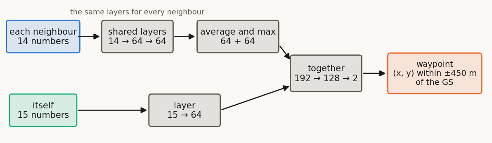

**Figure 6:** The actor network.

| | actor | critic |
|---|---|---|
| input | 15 (self) + 14 per neighbour | the whole network: 5 numbers per drone (25 × 5), plus the C-drone's own 15 numbers and the time: 141 in all |
| layers | neighbour 14 → 64 → 64 (average and max); self 15 → 64; together 192 → 128 → 2 | 141 → 128 → 128 → 1 |
| output | a waypoint, at most 450 m from the GS on each axis | the expected reward |
| used when flying | yes | no, training only |

**Table 11:** The two networks.

**Learning**

Training repeats one cycle, called an update:
1. **Fly:** the C-drones fly 40 runs with the current actor, without
   changing it. Each C-drone decides once a second, so this gives about
   28,000 decisions, each with the reward that followed it.
2. **Learn:** the decisions are split into batches of 1024. The
   networks adjust their weights a little after each batch, and go over
   all the batches 5 times, shuffling them each time.
3. **Start again:** the decisions are thrown away, and the next update
   flies with the new actor.

We ran 400 updates and kept the actor that did best on the validation
layouts.

| setting | value |
|---|---|
| method | PPO with a shared critic (MAPPO) |
| clip | 0.1 |
| optimizer | Adam, learning rate 0.0003 |
| discount (γ) / GAE (λ) | 0.97 / 0.95 |
| exploration | random noise around the chosen waypoint (about 45 m) during training; none when testing |

**Table 12:** The learning settings.

The clip keeps each update small: once a decision has become about 10%
more or less likely than before, the update stops pushing it further.
<!-- source: rl_sim/scripts/train_c_ppo_round2.py lines 545-568 (5 passes, torch.randperm each pass, minibatches of MINIBATCH=1024, one optimiser step per minibatch); decisions per update from rl_sim/out/2c_r2_log_A.csv (27720 = 40 runs x 7 C-drones x 99) and 2c_r2_log_B.csv (17424-25146, mean 21737, smaller fleets in varied missions); 400 updates and keep-best on validation are round 2's settings (UPDATES, evaluate every 10 updates) -->
<!-- source: rl_sim/fanet_sim/envs/c_interface.py (features, reward, global state), rl_sim/agents/c_actor.py (layers), rl_sim/scripts/train_c_ppo.py (GAMMA, GAE_LAMBDA, CLIP, EPOCHS_PER_UPDATE, LEARNING_RATE, MINIBATCH), rl_sim/scripts/train_c_ppo_m4.py (EPISODES_PER_UPDATE_M4 = 40), rl_sim/fanet_sim/config.py (C_FLIGHT_COST, C_DRONE_SPEED, SHARE_TARGETS) -->

**The mission**

All drones start within 100 m of the
GS. Each M-drone gets a random direction, a speed of 10–30 m/s and a
start delay of 0–50 s, then flies 325–650 m outward and hovers there.
650 m is the bound: the farthest point of the area, a corner, is about
622 m from the GS, so a longer flight would just stop at the edge.
This lets us set how far the network spreads, instead of leaving it to
where each drone happened to start.
<!-- source: rl_sim/fanet_sim/config.py — MISSION "near_gs", START_RADIUS_M=100, MISSION_DISTANCE_M (D=650 in every Phase 2c result below), DRONE_SPEED_MIN/MAX=10/30, MAX_START_DELAY_S=50; rl_sim/fanet_sim/envs/fanet_env.py _assign_mobility — distance uniform in [0.5 D, D] = [325, 650] m, clipped inside the border. Corner: 450*sqrt(2) = 636 m from the GS, minus the 10 m border margin along the diagonal = 622 m (FAR_M in rl_sim/scripts/train_c_ppo_round2.py); at D = 650, 50.4% of end points are clipped at the border (rl_sim/out/2c_curriculum1b_summary.csv). -->

**Training**

We trained the agent in two steps:
1. **Copy midpoint:** we recorded 140,000 of midpoint's decisions and
   trained the actor to predict midpoint's waypoint from what the
   C-drone saw. Its waypoints ended up 31 m from midpoint's on average,
   a sensible start instead of random flying.
2. **PPO:** PPO then trained the actor in the full mission, with the
   M-drones flying up to 650 m out, using the learning cycle described
   above, for about 1,600 updates. Every 10 updates we tested it on the
   validation layouts and kept the best version. This is the RL agent
   in the results below.

The agent trained on layouts 101–300, was chosen on layouts 301–330,
and was tested on layouts 601–650, which no part of the work had used
before.
<!-- source: staged vs direct at equal budget from commit b9e4162 (rl_sim/out/2c_curriculum_staged_curve.csv, 2c_curriculum_direct_curve.csv): validation 301-330 at D=650, direct 16.69, staged 21.00, 1240 updates each. "400 more updates" = round 1 control, rl_sim/out/models/2c/c_actor_r1_control.pt. Spacing penalty: rl_sim/out/2c_r1_test_paired.csv, spacing_large minus control -0.74 on 501-550 and -0.27 on 401-450. -->

**Edge cases**

A good average over random layouts can hide situations where the
agent fails, and random layouts rarely contain the hard ones. So we
built 13 cases by hand, each with a clear right answer. For example,
when one M-drone flies far away alone, a C-drone should follow it and
relay its packets. We ran each case five times, to check that the agent
behaves sensibly, not only that it loses little on average.

Table 13 comes from running the trained RL agent (as explained in
Training above) and the midpoint rule on each case, with the agent
frozen, greedy routing and 200 ms load as in Table 14. It shows the 9
cases where they differ.

| case | what happens | RL agent | midpoint rule |
|---|---|---|---|
| 1 | 1 M-drone, 1 C-drone; the M-drone flies 600 m away | 88.7% | 17.8% |
| 2 | 1 M-drone, 3 C-drones; the M-drone flies to a corner | 88.0% | 28.0% |
| 3 | 1 M-drone, 2 C-drones; the M-drone flies 600 m, waits 20 s, and comes back | 50.0% | 8.8% |
| 4 | 1 M-drone, 1 C-drone; the M-drone flies to a corner | 88.7% | 25.2% |
| 5 | 1 M-drone, 7 C-drones; the M-drone flies 600 m away | 87.1% | 33.3% |
| 6 | full fleet; 1 M-drone flies to a corner | 77.4% | 86.6% |
| 7 | full fleet; 3 M-drones fly to three different corners | 72.5% | 82.3% |
| 8 | full fleet; 1 M-drone flies to a corner and back | 41.0% | 49.4% |
| 9 | full fleet; 9 M-drones fly together to one side | 16.6% | 72.4% |

**Table 13:** Edge cases: % of the packets of the M-drones that fly
away that never reach the GS, mean of 5 runs.
<!-- source: rl_sim/out/2c_r2_edge.csv — flying_m_loss, policies control (RL agent), B (RL, varied), midpoint; run seeds 9900-9904, placement seed 900; scenario definitions in rl_sim/scripts/edge_cases_2c.py. Report case numbers 1-9 are script scenarios 1, 2, 5, 6, 8, 9, 10, 12, 13. Script scenarios 3, 4, 7 and 11 are left out: 4 and 11 are the same for all three (0.8 and 9.2), 3 is above 80% for all three (88.3 / 84.1 / 81.6), and in 7 the RL agents beat midpoint (17.2 / 19.1 / 25.8). -->

The cases show a weakness. When few drones are left and one flies far
away (cases 1–5), the agent keeps its C-drones near the GS and the far
drone loses almost all its packets, while midpoint follows it. In the
full fleet (cases 6–9), where the agent was trained, it does better
than midpoint in every case.

| midpoint rule | RL agent |
|---|---|
| 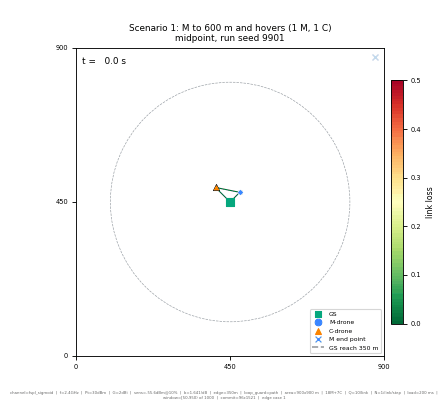 | 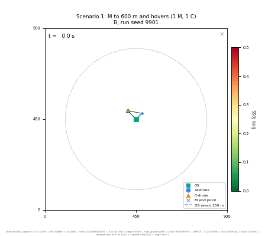 |

**Figure 7:** Edge case 1: one M-drone and one C-drone. Midpoint flies
the C-drone to the middle and keeps the M-drone connected; the RL
agent's C-drone stays at the GS and the M-drone is cut off.
<!-- source: GIFs drawn from saved recordings, run seed 9901 (rl_sim/out/2c_edge_r1_control/rec), copied by rl_sim/scripts/report_figures_2c.py -->

**Training on varied missions**

The agent had only ever trained in one kind of world. So we trained it
again, from the model before the 400 extra updates, in the same way but
with a new random world in every run: half the runs were the full-fleet
mission, and half a varied world with 1–18 M-drones, 1–7 C-drones and
one of four mission types:

| type | what the M-drones do |
|---|---|
| spread | every M-drone flies outward, as in the full-fleet mission, but only up to a random 300–650 m |
| lone flyers | 1–3 M-drones fly to a random point 450–622 m from the GS; the rest hover where they start |
| group | half the M-drones fly to points 450–622 m away, all within 20° of one random direction; the rest hover |
| out and back | like lone flyers, but each flyer waits 10–30 s at its far point and then flies back to where it started |

We kept the version with the lowest average loss over the full-fleet
validation layouts and 30 varied validation worlds (331–360).
<!-- source: rl_sim/scripts/train_c_ppo_round2.py — draw_varied (n_M 1-18, n_C 1-7, types a-d, SPREAD_D_M 300-650, FAR_M 450-622, HOVER_S 10-30), VARIED_SHARE 0.5, keep-best on the mean of full 301-330 and varied 331-360; run B, best at update 100. Test sets in rl_sim/scripts/evaluate_r2_test.py. -->

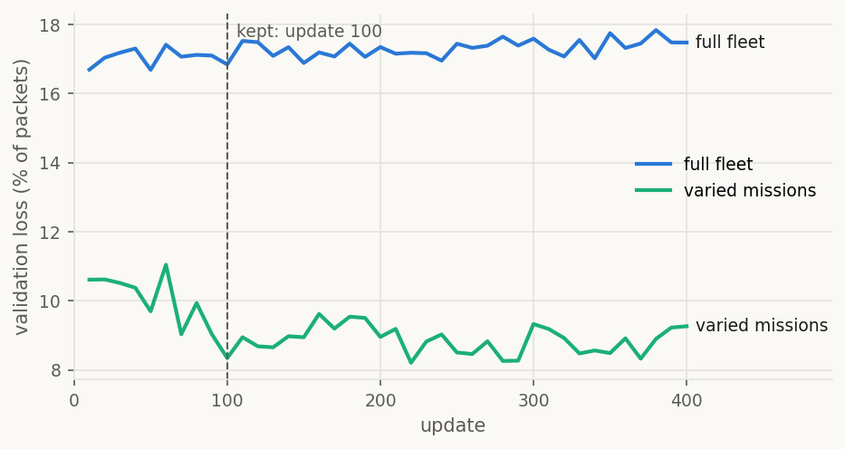

**Figure 8:** Validation loss while training on varied missions.

In the first 100 updates the varied-mission loss fell from 10.6% to
8.3% while the full-fleet loss held at about 16.8%. Neither improved
after that, so we kept update 100.
<!-- source: rl_sim/out/2c_r2_curve_B.csv (run B): update 10 full 16.69 varied 10.61; update 100 full 16.84 varied 8.34 (best average 12.59); after update 100 full 16.88-17.83, varied 8.21-9.62. Figure from rl_sim/scripts/report_figures_2c.py. -->

**Results**

We tested both RL agents on 50 new full-fleet layouts (601–650) and on
100 new varied missions (651–750, 25 of each type). No part of the work
had used these layouts before.

| how the C-drones move | total loss | lost on the channel | queue full | no route to the GS | sent to a drone that had left |
|---|---|---|---|---|---|
| hover (stay where they start) | 25.9% | 12.8% | 4.1% | 3.7% | 4.9% |
| midpoint rule | 24.3% | 9.1% | 9.2% | 1.3% | 4.5% |
| RL agent (trained on the full fleet) | **16.4%** | 8.4% | 3.0% | 0.2% | 4.7% |
| RL agent (also trained on varied missions) | **16.4%** | 8.6% | 2.9% | 0.3% | 4.7% |

**Table 14:** Packet loss in the full fleet (18 M + 7 C), 50 test
layouts, greedy routing, 200 ms, % of packets created.
<!-- source: rl_sim/out/2c_r2_test.csv, set=full (layouts 601-650): hover, midpoint, control (RL agent trained on the full fleet, 16.35), B (also trained on varied missions, 16.44; channel 8.59, queue_full 2.86, no_route 0.31, stale_link 4.66). Small causes (dead end, ttl, hop limit, link broken) are all at most 0.2 and are left out. -->

| how the C-drones move | all missions | spread | lone flyers | group | out and back |
|---|---|---|---|---|---|
| hover (stay where they start) | 17.6% | 20.4% | 15.4% | 24.6% | 9.8% |
| midpoint rule | **9.2%** | **14.1%** | 8.7% | **8.9%** | **5.2%** |
| RL agent (trained on the full fleet) | 12.9% | 16.5% | 12.3% | 14.5% | 8.1% |
| RL agent (also trained on varied missions) | 10.4% | 15.0% | **6.9%** | 11.8% | 7.6% |

**Table 15:** Packet loss on 100 varied test missions (25 of each
type), greedy routing, 200 ms, % of packets created.
<!-- source: rl_sim/out/2c_r2_test.csv, set=varied (layouts 651-750): hover, midpoint, control (RL agent), B (RL, varied); totals and per-type means -->

Varied training cut the loss on varied missions from 12.9% to 10.4%
at no cost in the full fleet. The agent is now level with midpoint on
varied missions and still 7.9 points better in the full fleet. In the
edge cases it fixed case 5 and halved the loss in cases 6 and 8, but
cases 1–4 still fail.

| before varied training | after varied training |
|---|---|
| 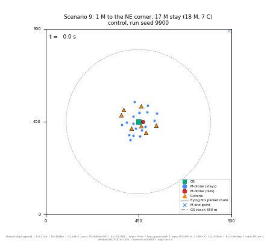 | 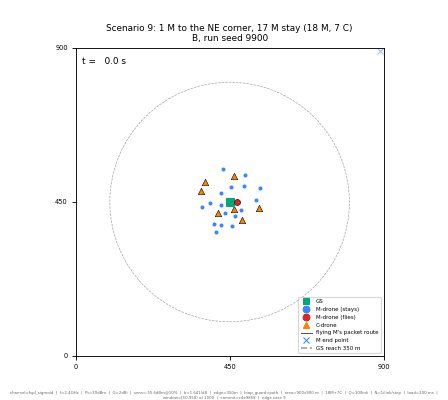 |

**Figure 9:** Edge case 6: one M-drone (red) flies to the far corner.
Before varied training it is cut off (86.9% lost); after, a C-drone
follows and relays its packets (31.8% lost).
<!-- source: GIFs drawn from saved recordings, run seed 9900 (rl_sim/out/2c_edge_bigfleet_r2_control/rec and rl_sim/out/2c_edge_bigfleet_r2_B/rec); per-run loss_flying from rl_sim/out/2c_edge_bigfleet_r2_control/edge_runs.csv (86.9) and rl_sim/out/2c_edge_bigfleet_r2_B/edge_runs.csv (31.8); copied by rl_sim/scripts/report_figures_2c.py -->

---

## 12. Summary: Difficulties, Further Work, Conclusion

**Difficulties**

- **Choosing the environment.** Small choices in the world decide how
  much there is to learn. With a short link range many layouts leave
  drones cut off; with a long one most drones reach the GS directly and
  there is little to route. We compared ranges from 300 to 450 m on
  3000 random layouts and chose 350 m, where about 95% of layouts are
  connected and about half the M-drones still need a relay. For the
  moving world we also had to design a mission whose spread we could
  control (section 11).
- **Choosing the loss model.** It started as a hard wall at 250 m.
  We replaced it with an S-curve where the receiver's sensitivity means
  10% loss, as in 802.11, and later made the curve steeper, so the loss
  climbs from 10% to 50% between 300 and 350 m. Each change meant
  re-running every result.
<!-- source: link-edge choice — CLAUDE.md "Link existence" (edges 300-450 m on 3000 random layouts, rl_sim/out/edge_scan.csv: 350 m, ~95% of layouts connected, 52% of M-drones need a relay); loss-model history — CLAUDE.md "Channel loss" History (wall at 250 m, S-curve with the 10% point at 249.689 m, moved to 300 m on 2026-10-16); mission — rl_sim/fanet_sim/config.py MISSION comment ("border" flight length decided by chance, "near_gs" a dial) -->

**Further work**

- **RL routing in the moving world** (Phase 2b), and the routing and
  C-drone agents together (Phase 2d).
- **Acknowledgements while moving.** The routing agent learns from the
  GS's acknowledgement walking back along the packet's path. When
  drones move, that path may be gone. One plan is for the GS to send
  the acknowledgement back along the path and measure how often it
  arrives; another is GS beacons [10].
- **Small fleets.** Train the C-drone agent more on small fleets, or
  let a real system fall back to midpoint when there are few drones.
- **Channel loss.** Most of the routing agent's remaining loss is on
  the channel, on links it had no better alternative to.
  Retransmissions would attack this, but first we must check whether
  our loss curve already includes the radio's own retries.
- **Hidden costs.** Hello messages and acknowledgements are free in our
  simulator; they take no queue space and no link time.

**Conclusion**

We built a drone-network simulator and used it to ask whether RL can
lose fewer packets than simple rules.
- **Routing, static world:** the RL router lost 10.8% of the packets,
  against 11.9% for the best simple rule and 25.0% for greedy.
- **Moving world:** where the C-drones fly matters; midpoint cut
  greedy's loss from 44.5% to 29.1%.
- **C-drone placement with RL:** in the full fleet the RL agent lost
  16.4% against 24.3% for midpoint. Trained also on varied missions, it
  is level with midpoint there and keeps its full-fleet lead, but it is
  still weaker in small fleets.

RL helps most in large, busy networks; in small ones a simple rule is
as good or better.
<!-- source: rl_sim/out/1b_test50_runs.csv (rl 10.77, rate 11.93, greedy 24.97 at 200 ms); rl_sim/out/2a_final_summary.csv (greedy hover 44.5, midpoint 29.1); rl_sim/out/2c_r2_test.csv (full fleet: RL agent 16.35, midpoint 24.34; varied: 10.35 vs 9.22); rl_sim/out/2c_r2_test_by_fleet.csv (1-6 M-drones: 18.72 vs 11.01). Channel diagnosis for "most remaining loss is channel": CLAUDE.md / rl_sim/out/1b_channel_diagnosis.csv. Retries question and ACK plan: CLAUDE.md open questions. Hellos free: rl_sim/fanet_sim/config.py (hello comment). -->

---

## 13. References

1. B. Karp and H. T. Kung, "GPSR: Greedy Perimeter Stateless Routing for Wireless Networks," in *Proc. ACM MobiCom*, 2000.
2. R. S. Sutton and A. G. Barto, *Reinforcement Learning: An Introduction*, 2nd ed. MIT Press, 2018.
3. J. Schulman, F. Wolski, P. Dhariwal, A. Radford and O. Klimov, "Proximal Policy Optimization Algorithms," arXiv:1707.06347, 2017.
4. C. Yu, A. Velu, E. Vinitsky, J. Gao, Y. Wang, A. Bayen and Y. Wu, "The Surprising Effectiveness of PPO in Cooperative Multi-Agent Games," in *NeurIPS Datasets and Benchmarks Track*, 2022.
5. IEEE Std 802.11-2020, *Wireless LAN Medium Access Control (MAC) and Physical Layer (PHY) Specifications*, OFDM PHY: receiver minimum input sensitivity (10% packet error rate on 1000-octet frames).
6. M. Zúñiga and B. Krishnamachari, "Analyzing the Transitional Region in Low Power Wireless Links," in *Proc. IEEE SECON*, 2004.
7. D. Halperin, "Simplifying the Configuration of 802.11 Wireless Networks with Effective SNR," PhD thesis, University of Washington, arXiv:1301.6644, 2013.
8. T. Clausen and P. Jacquet (eds.), "Optimized Link State Routing Protocol (OLSR)," RFC 3626, IETF, 2003.
9. Y. Rekhter, T. Li and S. Hares (eds.), "A Border Gateway Protocol 4 (BGP-4)," RFC 4271, IETF, 2006 (the AS_PATH attribute).
10. B. Sliwa, C. Schüler, M. Patchou and C. Wietfeld, "PARRoT: Predictive Ad-hoc Routing Fueled by Reinforcement Learning and Trajectory Knowledge," in *Proc. IEEE VTC2021-Spring*, 2021.

---

## 14. Appendix

**Layouts used**

Each layout is a random placement of the drones, named by its seed.
A layout used for testing is never used again.

| layouts | used for |
|---|---|
| 1–50 | Phase 1 test; Phase 2a test |
| 101–300 | training (Phase 1b and Phase 2c) |
| 301–330 | validation (Phase 1b used 301–310) |
| 331–360 | validation, varied missions (Phase 2c) |
| 401–450, 501–550 | earlier Phase 2c tests |
| 601–650 | Phase 2c final test, full fleet |
| 651–750 | Phase 2c final test, varied missions |
| 900 | Phase 2c edge cases |
<!-- source: README.md layout-seed table; Phase 2a test 1-50 from rl_sim/out/2a_final_runs.csv -->

**Reproducing the results**

All code is in `rl_sim/`. Every figure and table file carries a stamp
with the settings and the code version that produced it, and every
number in this report has a hidden comment naming the file it comes
from.
